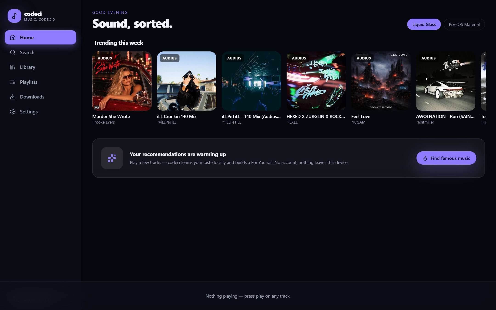
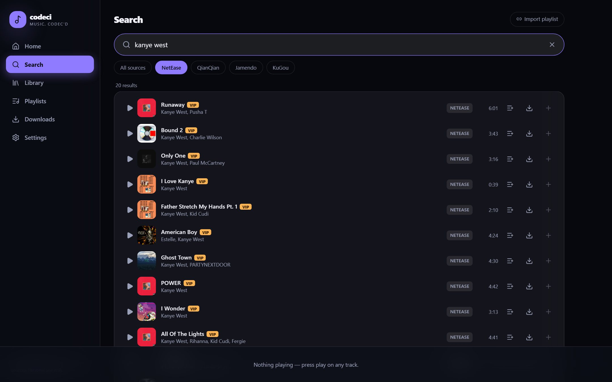
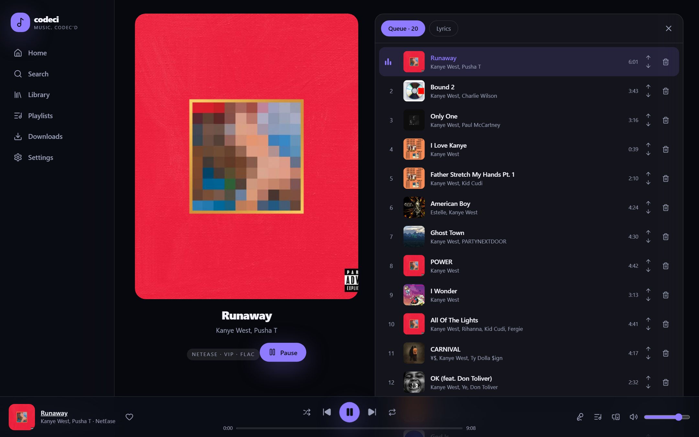
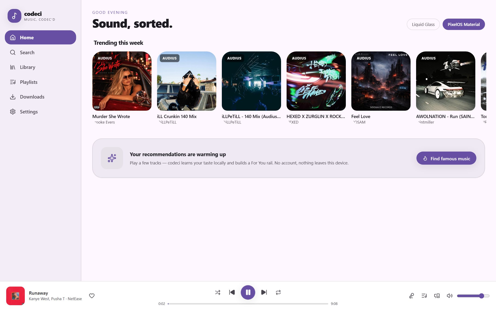
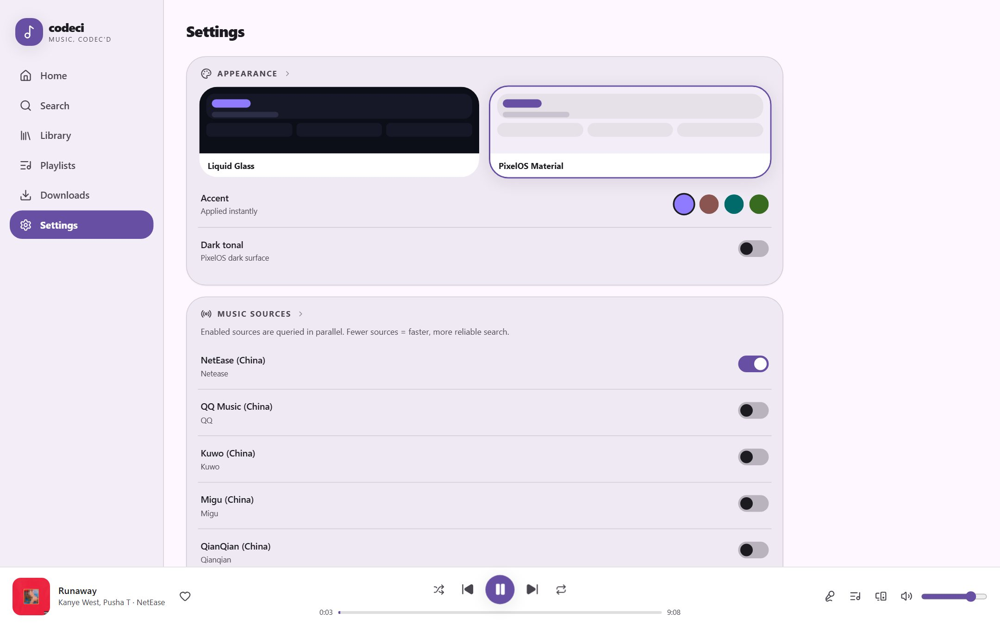
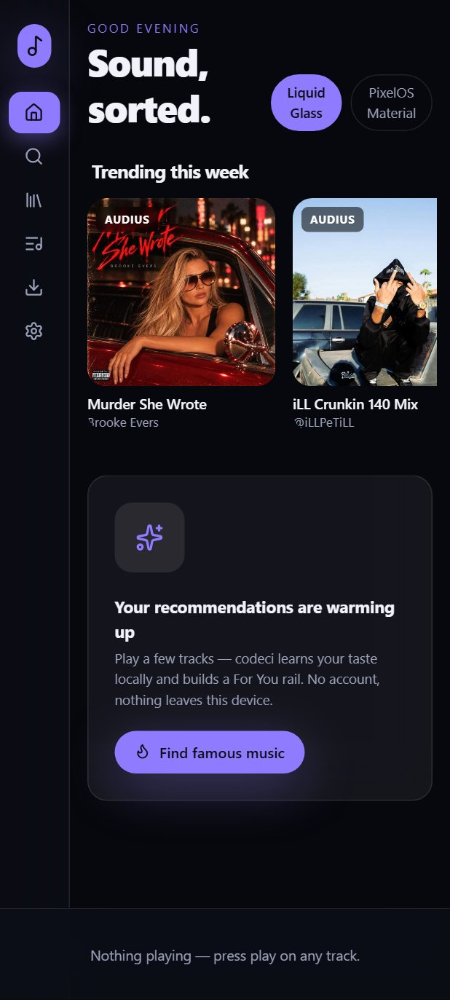

# codeci

> **codec** as in *music, got it*. A music app for Windows, CachyOS Linux and Android, built on [musicdl](https://github.com/CharlesPikachu/musicdl) — search the mainstream catalogs (NetEase, QQ, Kuwo, Migu…) or the open/CC catalog on-device, stream, download and organize it, with two themes: **Liquid Glass** and **PixelOS Material**.

[](LICENSE)
[]()



---

## Why codeci

The desktop experience (<kbd>Windows</kbd> + <kbd>CachyOS</kbd>) gets the **full musicdl catalog** — including mainstream Kanye/weeknd/you-name-it lossless FLACs from NetEase etc. — through a bundled Python sidecar (`codeci-backend`, FastAPI). The Android APK (<kbd>Tauri v2</kbd>) is self-contained and ships the open/CC catalog (Audius, Wikimedia Commons, Jamendo with a free client_id, FMA/ccMixter planned): everything runs on-device, no server, no PC.

| Feature | Desktop | Android APK |
|---|---|---|
| Mainstream sources (NetEase/QQ/Kuwo/Migu…) | ✅ via sidecar | via external backend (Termux), post-v1 |
| Open/CC sources on-device (Audius, Wikimedia…) | ✅ | ✅ |
| Search / stream / download | ✅ | ✅ (open catalog) |
| Playlist URL import | ✅ | planned |
| Offline library, playlists, likes, history | ✅ (SQLite) | ✅ (SQLite, rusqlite) |
| Recommendation engine (local, Spotify-style) | ✅ rolling out | ✅ rolling out |
| Lyrics (LRC) | ✅ inline from sidecar | planned (open sources) |
| Themes: Liquid Glass / PixelOS Material | ✅ | ✅ |
| Windows installer | ✅ NSIS (planned) | — |
| Arch/CachyOS package | ✅ PKGBUILD | — |

## Screenshots

| Liquid Glass (home + search) | Now Playing — live queue |
|---|---|
|  |  |

| PixelOS Material | Settings — themes |
|---|---|
|  |  |



### Windows performance notes (measured 2026-11-13)

musicdl resolves download URLs + probes them per result, so search is not instant:

- **NetEase ~20–40 s** on intl networks (VIP probes at 10 s timeouts per track); results are then cached 10 min (repeat search = ~40 ms)
- **Migu/YouTube are effectively dead on this network**: Migu returns 0 tracks (>110 s of probes); YouTubeMusicClient needs ~176 s for 5 results
- Backend runs sources **in parallel with a 45 s per-source cap** — slow sources are dropped, never blocking fast ones
- Default sources = **NetEase only**; QQ/Kuwo/Migu/YouTube remain toggles in Settings (YouTube note says ~3 min — don't enable casually)
- CachyOS (CN users): all five mainland sources are fast — re-enable them in Settings

## Quick start

### Prerequisites

- Node.js ≥ 20, Rust ≥ 1.85, Python ≥ 3.11 (sidecar)
- Windows/Linux (macOS best-effort)
- Optional: `ffmpeg` on PATH for some VIP sources; Node.js for YouTube Music

### 1. Backend sidecar (desktop)

```bash
cd backend
python -m venv .venv
.venv/Scripts/activate              # or: source .venv/bin/activate
pip install -r requirements.txt
python -m app.main --port 8787      # /docs at http://127.0.0.1:8787/docs
```

Note for Windows: if Smart App Control (SAC) blocks `pycryptodomeX` DLLs, either allow them or start with `CODECI_CRYPTODOME_SHIM=auto` (already the default — it falls back to `pycryptodome`, the same library).

### 2. Frontend (dev)

```bash
cd frontend
npm install
npm run dev          # http://localhost:1420 — talks to the sidecar on :8787
```

### 3. Desktop app (verified 2026-11-13)

```powershell
# from the repo root — the CLI lives in frontend/node_modules:
.\frontend\node_modules\.bin\tauri.cmd dev
```

Opens the codeci window; the sidecar spawns itself on a free port (see `docs/android-setup.md` for why 8787 is the manual fallback), `library.db` lands in `%APPDATA%\dev.xonix97.codeci\`.

`npm run build` in `frontend/` produces the static bundle used by the Tauri build.

### 3. Rust core (library, sources, recs)

```bash
cargo test -p codeci-core
cargo run -p codeci-core --example audius_smoke -- "kanye west"
```

## Project layout

```
core/       codeci-core (Rust): SQLite library, downloads, open sources, local recommender
backend/    codeci-backend (FastAPI + musicdl): search/download/proxy/playlist/lyrics sidecar
frontend/   React + Vite + Tailwind UI — one codebase for desktop & mobile, both themes
src-tauri/  Tauri v2 shell (desktop first, Android APK target)
docs/       musicdl API probe notes, API contract, screenshots
plan.md     Full build plan & decisions
```

## Recommendations ("Spotify-style", but local)

`codeci-core::recs` builds a single-user taste profile from your play history:

- **Decayed signals** — half-life 30 days: plays/skips/completions/likes
- **Taste vector** — artist + genre weights (cosine similarity for candidates)
- **Co-play matrix** — track×track co-occurrence ("Because you played X")
- **ε-greedy exploration** — 20% of recommendations explore new artists
- **Ranking** — `0.45·genre_sim + 0.25·artist_affinity + 0.20·popularity + 0.10·novelty − skip_penalty`
- **Radio mode** — station built from the current track

All local, SQLite-backed, no account, no network. Honest limits: no cross-user collaborative filtering or audio-feature DSP in v1. Reset your profile anytime in Settings → Recommendations.

## Legal / license

codeci is **noncommercial** — [PolyForm Noncommercial 1.0.0](LICENSE), like its upstream [musicdl](https://github.com/CharlesPikachu/musicdl). Personal use only; don't redistribute as part of a commercial product. codeci does not host or distribute any copyrighted content; VIP/lossless access is via your own logins/cookies. On Android, the on-device catalog is open/CC-licensed by construction.

## Roadmap

- [x] Phase 0 — repo, license, musicdl probe & schema docs
- [x] Phase 1 — `codeci-core`: library, sources (Audius/Jamendo/Wikimedia), recs engine, downloads, sidecar client (8/8 tests)
- [x] Phase 2 — `codeci-backend`: FastAPI wrapper (search/lyrics/playlist/download/streaming proxy with Range) + Windows PyInstaller script, CachyOS PKGBUILD + systemd user unit
- [x] Phase 3 — Frontend MVP: both themes, Search (live), Now Playing + queue, Settings, Home rails (Audius trending live)
- [ ] Phase 4 — Tauri desktop shell: sidecar lifecycle, tray, media keys, NSIS/MSI
- [ ] Phase 5 — Android APK (on-device CC catalog; SDK install pending, see [docs/android-setup.md](docs/android-setup.md))
- [ ] Phase 6 — Release pipeline + Termux backend guide

## Docs

- [plan.md](plan.md) — full plan, risks, phases
- [docs/musicdl-schema.md](docs/musicdl-schema.md) — musicdl 2.14.2 `SongInfo` schema probe
- [docs/screenshots/](docs/screenshots/) — README assets (regenerate: `cd frontend && node shots.mjs`)
